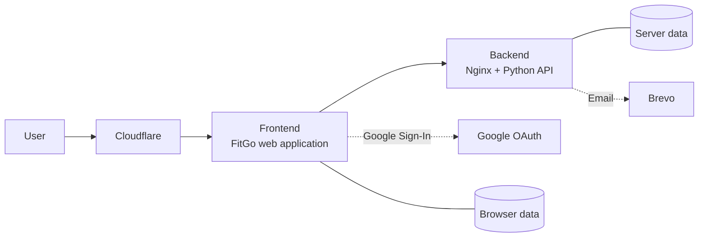

# Murilo Bellatini

> Software, data, and cloud engineering · 8+ years  
> M.Sc. Robotics & AI, Technical University of Munich

I build AI platforms that people can actually use.

At BMW, I lead the technical direction of an internal platform for building and sharing AI agents.

I design the architecture, set the quality bar, and own what ships.

AI agents accelerate development. I make sure the result works.

📍 Munich, Germany  
🎯 Open to Staff AI Platform Engineer and hands-on Tech Lead roles

[About Me](https://muriloapps.dpdns.org/me/d) · [CV](https://muriloapps.dpdns.org/me/cv.pdf) · [LinkedIn](https://www.linkedin.com/in/mbellatini/)

***

## Portfolio

<strong>Enterprise AI Platforms</strong>

 

<strong>BMW — AI Platform Engineering</strong>

 

BMW employees wanted to build their own AI agents, but had no simple or safe way to do so.

We built an internal self-service platform that now serves more than 70,000 users per month.

I led the platform technically from concept through company-wide release.

**Role:** Technical Lead · AI Platform Engineering

Impact

- Delivered the initial platform concept within three months and reached general availability within six.
- Scaled adoption to more than 70,000 monthly users, with approximately 7,000 daily users.
- Led a cross-functional team of more than 15 engineers across development, quality assurance, and user experience.
- Maintained compliance with no reported security or compliance breaches since 2024.

Technical leadership

- Co-designed the branching, testing, and deployment strategy across contributing teams.
- Introduced user acceptance testing, staged rollouts, and automated Playwright end-to-end checks.
- Built self-service benchmarking for agent builders.
- Designed a quality-analysis framework for evaluating agent performance.
- Enabled cross-functional teams through shadowing and reverse shadowing.

<strong>AI-Native Product Delivery</strong>

 

<strong>FitGo — Home Fitness Application</strong>

 

Fitness applications often introduce unnecessary complexity.

FitGo takes a different approach: one button, press play, follow along.

I built it as a personal product and as a demonstration of AI-native development. AI agents wrote much of the code, while I owned the product direction, architecture, specifications, review, and quality.

**Role:** Product Owner · Architect · Engineer

**[Open FitGo](https://muriloapps.dpdns.org/fitgo/)**

Product demonstration

  <video src="https://github.com/user-attachments/assets/47fb315b-e386-4b86-aff1-ef136eb6063d" controls width="320px" muted playsinline>
    <a href="https://github.com/user-attachments/assets/47fb315b-e386-4b86-aff1-ef136eb6063d">Watch the demonstration</a>
  </video>

Architecture

- **Infrastructure:** Cloudflare edge, web frontend, and a Python API behind Nginx, hosted on a Raspberry Pi.
- **Authentication and communication:** Google Sign-In for cross-device synchronisation and Brevo for newsletter delivery.
- **Data:** Browser-based and server-side storage, separated by responsibility.

Engineering practices

- Implemented 34 Playwright end-to-end tests as part of the pre-merge quality gate.
- Delivered through staged integration and production deployments.
- Automated smoke and core-test checks before release.
- Applied opt-in analytics, consent-based feedback, retention controls, and scheduled data purges.

<strong>Applied AI Research</strong>

 

<strong>Alma PHIL — Conversational Knowledge Graphs</strong>

 

Conversations contain important context: the people involved, where they live, and what matters to them. Chatbots, however, typically do not retain this context.

For my master’s research at [Alma PHIL](https://almaphil.de/), I investigated whether conversations could be transformed into a personal knowledge graph and used to retrieve the people, places, and topics relevant to the current conversation.

This work became my master’s thesis at the [Technical University of Munich](https://www.tum.de/).

**Role:** Researcher · Machine Learning Engineer

Research approach

- Trained machine-learning models to extract relationships from conversations.
- Constructed a knowledge graph from the extracted entities and relationships.
- Used the graph to retrieve contextually relevant people, places, and topics.

Evaluation and limitations

- Evaluated relationship extraction using precision, recall, and F1 score.
- Identified a key limitation: publicly available training data did not closely match real healthcare conversations.
- Used the findings to define the scope and limitations of the approach.

Demonstration

<a href="https://youtu.be/K1lbAF3LXgk">
   
  Watch the demonstration on YouTube
</a>

<strong>Teaching and Knowledge Sharing</strong>

 

<strong>Practical Data Analysis Course</strong>

 

Data analysis can feel abstract: tools, theory, and terminology often appear before learners have the opportunity to answer a real question.

I developed **Estratégias de Análise de Dados** (*Strategies for Data Analysis*), a practical course for people transitioning into data analysis.

**Role:** Course Creator · Instructor

**[View the course](https://hotmart.com/pt-br/marketplace/produtos/estrategias-de-analise-de-dados)**

<strong>Earlier Projects</strong>

 

<strong>Dialog2Rasa</strong>

A tool for migrating chatbots from Dialogflow to Rasa.

**[View on GitHub](https://github.com/murilobellatini/dialog2rasa)**

<strong>Smart Poster</strong>

A tool for generating social-media posts.

**[View on GitHub](https://github.com/murilobellatini/smart-poster)**

<strong>SegmentStyler</strong>

A 3D styling tool driven by text input, developed at the Technical University of Munich with [Maximilian Winter](https://github.com/MaximilianWinter).

**[View on GitHub](https://github.com/MaximilianWinter/SegmentStyler)**

***

## Technical Skills

AI platform focus

- Large language model agents
- Model Context Protocol (MCP)
- Agent-to-Agent communication (A2A)
- Skills and tool use
- Retrieval-augmented generation (RAG)
- LLM evaluation
- Human-in-the-loop workflows
- Security and compliance

