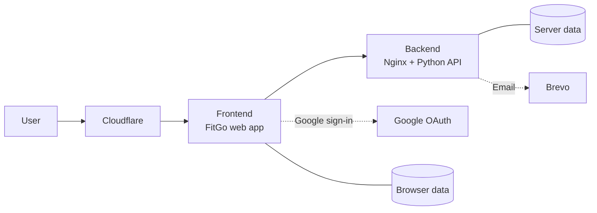

# Hi, I'm Murilo

> 8+ years in software, data, and cloud  
> M.Sc. Robotics & AI, TU Munich

I build AI platforms people can actually use.

At BMW, I lead the technical direction of an internal platform for building and sharing AI agents.

I design the architecture.  
I set the quality bar.  
I own what ships.

AI agents speed up the building.  
I make sure it works.

📍 Munich  
🎯 Open to Staff AI Platform Engineer and hands-on Tech Lead roles

[About Me](https://muriloapps.dpdns.org/me/d) · [CV](https://muriloapps.dpdns.org/me/cv.pdf) · [LinkedIn](https://www.linkedin.com/in/mbellatini/)

***

## My Portfolio

A few highlights of what I've built:

### Overview

- [BMW: AI Platform Engineering](#bmw-ai-platform-engineering)
- [FitGo: Home Fitness App](#fitgo-home-fitness-app)
- [Alma PHIL: Knowledge Graphs from Conversation](#alma-phil-knowledge-graphs-from-conversation)
- [Built by hand, before AI](#built-by-hand-before-ai)
- [Teaching](#teaching)

### BMW: AI Platform Engineering

BMW employees wanted to build their own AI agents.

Most had no easy, safe way to do it.

So we built an internal self-service platform.

Today, 70,000+ people use it every month.

I led it technically from concept to company-wide release.

<strong>How I work</strong>

- Co-designed branching, testing, and deployment strategy across teams.
- Introduced UAT, staged rollouts, and automated Playwright E2E checks.
- Built self-service benchmarking for agent builders.
- Designed quality analysis framework for agent performance.
- Enabled cross-functional teams through shadowing and reverse shadowing.

***

### FitGo: Home Fitness App

Fitness apps got too complicated.

So I built my own.

One button. Press play. Follow along.

Built for myself. A showcase of AI-native development:

- AI agents wrote much of the code
- I owned product, architecture, specs, review, and quality
- Now entering validation with real users

#### Watch the demo

  <video src="https://github.com/user-attachments/assets/47fb315b-e386-4b86-aff1-ef136eb6063d" controls width="320px" muted playsinline>
    <a href="https://github.com/user-attachments/assets/47fb315b-e386-4b86-aff1-ef136eb6063d">🎬 Click here to watch</a>
  </video>

**[Try FitGo →](https://muriloapps.dpdns.org/fitgo/)**

<strong>Technical details</strong>

- **Architecture:** Cloudflare edge → web frontend → Python API behind Nginx, hosted on a Raspberry Pi.
- **Auth & email:** Google Sign-In for cross device data sync and Brevo for Newsletter.
- **Quality:** 34 Playwright E2E tests included in the pre-merge to shield delivery.
- **Delivery:** Staged INT/PROD deploys with automated smoke and core-test checks.
- **Privacy:** Opt-in analytics, consent-based feedback, retention controls, and scheduled data purges.

### Alma PHIL: Knowledge Graphs from Conversation

Conversations contain important context.

Who matters. Where they live. What they care about.

But chatbots usually forget it.

For my master’s research at [Alma PHIL](https://almaphil.de/), I explored a different approach:

Turn conversations into a personal knowledge graph.

Then use it to retrieve the people, places, and topics relevant to the current conversation.

<a href="https://youtu.be/K1lbAF3LXgk">
  <a href="https://youtu.be/K1lbAF3LXgk">🎬 Watch the demo on YouTube</a>
  
</a>

- Trained AI models to extract relationships from conversations
- Built a knowledge graph from the extracted entities and relationships
- Evaluated relationship extraction with precision, recall, and F1
- Found a key limitation: the public training data did not match real healthcare conversations

This became my master's thesis at [TU Munich](https://www.tum.de/).

***

### Built by hand, before AI

- [Smart Poster](https://github.com/murilobellatini/smart-poster): generates social media posts for you
- [Dialog2Rasa](https://github.com/murilobellatini/dialog2rasa): moves chatbots from Dialogflow to Rasa
- [SegmentStyler](https://github.com/MaximilianWinter/SegmentStyler): 3D styling from text, built at TU Munich with [Maximilian Winter](https://github.com/MaximilianWinter)

***

### Teaching

Data analysis can feel abstract.

Tools, theory, and buzzwords—before you ever answer a real question.

So I built a practical course for people moving into data analysis.

**Estratégias de Análise de Dados**  
*(Strategies for Data Analysis)*

[View the course →](https://hotmart.com/pt-br/marketplace/produtos/estrategias-de-analise-de-dados)
