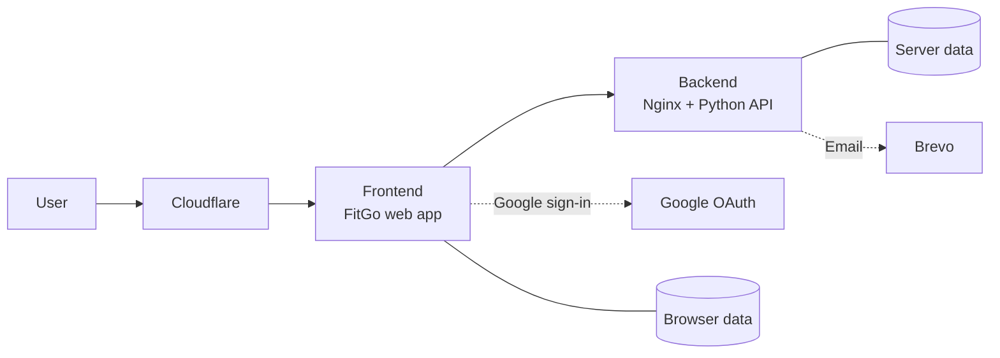

# Hi, I'm Murilo

> 8+ years in software engineering, data and cloud · M.Sc. Robotics & AI, TU Munich

I'm an AI Platform Engineer and Tech Lead on BMW's internal AI Assistant, where over 70,000 people each month build their own AI agents.

I design the architecture, set the quality bar, and own what ships.

AI agents speed up the building. I make sure it works.

📍 Munich · 🎯 Open to Staff AI Platform Engineer and hands-on Tech Lead roles

[About Me](https://muriloapps.dpdns.org/me/d) · [CV](https://muriloapps.dpdns.org/me/cv.pdf) · [LinkedIn](https://www.linkedin.com/in/mbellatini/)

***

## My Portfolio

A few highlights of what I've built:

### Overview

- [BMW: AI Platform Engineering](#bmw-ai-platform-engineering)
- [FitGo: Home fitness app](#fitgo-home-fitness-app)
- [Alma PHIL: Knowledge Graphs from Conversation](#alpha-phil-knowledge-graphs-from-conversation)
- [Built by hand, before AI](#built-by-hand-before-ai)
- [Teaching](#teaching)

### BMW: AI Platform Engineering

At BMW, I lead the technical direction of an internal AI platform where BMW employees build their own AI agents.

I focus on platform architecture, implementation design, and safe, staged releases.

<strong>How I work</strong>

- Co-designed branching, testing, and deployment strategy across teams.
- Introduced UAT, staged rollouts, and automated Playwright E2E checks.
- Built self-service benchmarking for agent builders.
- Ran cost and quality analysis for high-volume model usage.
- Enabled cross-functional teams through shadowing and reverse shadowing.

***

### FitGo: Home fitness app

A home fitness app with one button.

Press play and it shows you what to do, keeps you motivated, and takes the guesswork out of getting fit.

I designed the product, the rules, and the architecture.

AI agents wrote much of the code under my watch.

#### Watch the demo

  <video src="https://github.com/user-attachments/assets/47fb315b-e386-4b86-aff1-ef136eb6063d" controls width="320px" muted playsinline>
    <a href="https://github.com/user-attachments/assets/47fb315b-e386-4b86-aff1-ef136eb6063d">🎬 Click here to watch</a>
  </video>

**[Try FitGo →](https://muriloapps.dpdns.org/fitgo/)**

<strong>Technical details</strong>

- **Architecture:** Cloudflare edge → web frontend → Python API behind Nginx, hosted on a Raspberry Pi.
- **Auth & email:** Google Sign-In for cross device data sync and Brevo for Newsletter.
- **Quality:** 34 Playwright E2E tests included in the pre-merge to shield delivery.
- **Delivery:** Staged INT/PROD deploys with automated smoke and core-test checks.
- **Privacy:** Opt-in analytics, consent-based feedback, retention controls, and scheduled data purges.

### Alma PHIL: Knowledge Graphs from Conversation

For my master's research at [Alma PHIL](https://almaphil.de/), I built a system that turns chat conversations into a knowledge graph of personal relationships.

The goal was to preserve context and support people living with dementia.

- **Approach:** train AI models to construct the graph based on the conversation using public datasets
- **Evaluation:** confusion matrix for multilabel classification to assess if relationships where found and with the correct label 
- **Limits:** quality for productive delivery, due to data mismatch between health care conversation and the one used for testing [DialogRE](https://dataset.org/dialogre/)

This became my master's thesis at TU Munich.

***

### Built by hand, before AI

- [Smart Poster](https://github.com/murilobellatini/smart-poster): generates social media posts for you
- [Dialog2Rasa](https://github.com/murilobellatini/dialog2rasa): moves chatbots from Dialogflow to Rasa
- [SegmentStyler](https://github.com/MaximilianWinter/SegmentStyler): 3D styling from text, built at TU Munich with [Maximilian Winter](https://github.com/MaximilianWinter)

***

### Teaching

I also teach.

**Estratégias de Análise de Dados** (Strategies for Data Analysis) is a practical course for people moving into data analysis.

[View the course →](https://hotmart.com/pt-br/marketplace/produtos/estrategias-de-analise-de-dados)
