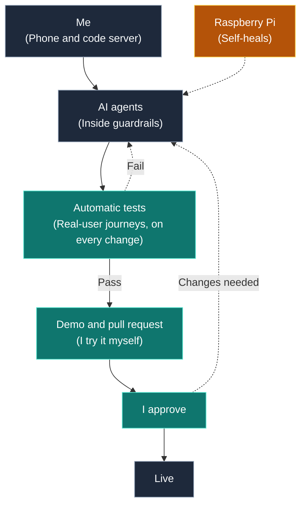
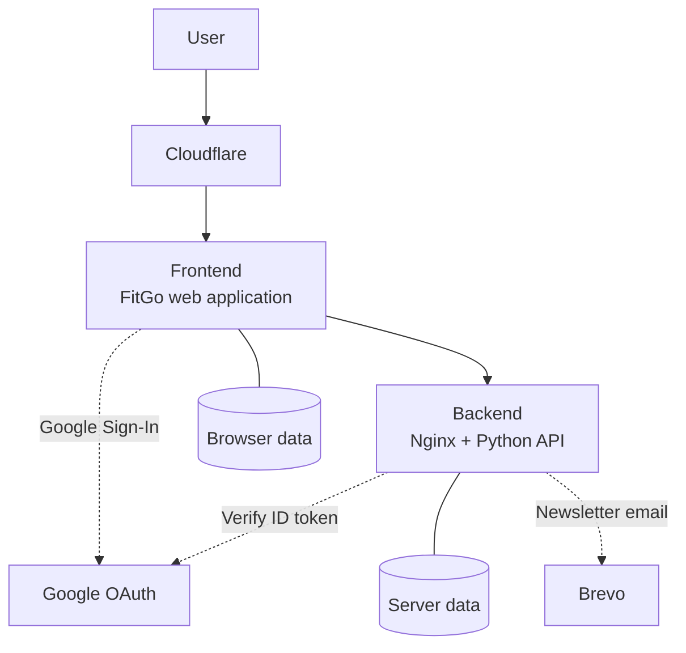

# Murilo Bellatini

> +8 years · Software, data, and cloud engineering  
> M.Sc. Robotics & AI, Technical University of Munich

I help companies get AI agents to work.

At BMW, I am technical lead for the generative AI agent platform. Employees build and run their own AI agents on it.

Based in Munich, Germany.

[About Me ↗](https://muriloapps.dpdns.org/me/) · [CV ↗](https://muriloapps.dpdns.org/me/cv.pdf) · [LinkedIn ↗](https://www.linkedin.com/in/mbellatini/)

---

## Portfolio

> Click on the rows to expand or collapse.

<strong>Enterprise AI Platforms</strong>

<blockquote>

BMW — AI Platform Engineering

<blockquote>

BMW employees needed an accessible, safe way to build their own AI agents.

We built an internal self-service platform that is now used by more than 70,000 people each month.

First test version after 3 months, company-wide launch after 6.

I own the platform core and co-designed the delivery process. 5+ teams ship on it.

Scope and outcomes

<blockquote>

- Internal self-service platform for building and sharing AI agents.
- Contributed to technical direction from concept through company-wide release.

</blockquote>

Technical contributions

<blockquote>

Delivery and quality

<blockquote>

- Co-designed branching, testing, and deployment strategies across teams.
- Helped introduce user acceptance testing and staged rollouts.
- Added automated Playwright end-to-end checks.

</blockquote>

Agent evaluation

<blockquote>

- Worked on self-service benchmarking for agent builders.
- Contributed to a quality-analysis framework for agent performance.

</blockquote>

Team collaboration

<blockquote>
Supported cross-functional teams through shadowing and reverse shadowing.

</blockquote>

</blockquote>

</blockquote>

</blockquote>

<strong>AI-Native Product Delivery</strong>

<blockquote>

AI Agents on a Raspberry Pi — Safe Agent Operations

<blockquote>

Agents are only useful if you can trust them.

I run AI agents on a small home server. They send me a demo and a pull request. I approve. I only review demos, so I move faster.

[Architecture ↗](agents.md) (the code is closed source)

Technical implementation

<blockquote>

Architecture and hosting

<blockquote>

[](https://mermaid.live/edit#pako:eNp1kl9r2zAUxb_KRXlZwSndkv6JOwqh6YJpS40X9pLsQbauEm2y5ElySyj97r2WvYwUpjdJ53fuuVd6ZZUVyFImtX2pdtwFWC02Bmg93q037BG_lu7mU76zBoEbAZ0cPLpndCcb9hPG4xuYL0k5z4Bv0QQfgcx4RcJty51wXGnfiXvf-TJCq45pg615UBUE9ANZINfjlirAL9s6g3ufgDWAVHAPlNBs8Z_Xiqwg595Hy7wgzwXWNiZtWq3B4Z-WrPtMEMhCBaj3HrU8cjmFb5QSTmM3_WleRNOn-zV11jTOPuOgf7rvgNuYxYNBFCiO0E5A24fsx936QUVu8MwoYcF9U6KjLLmKwb5TmvGO-vb9SP9a9Uylqb8FSuieCKTSOh19xi-zSZn44OxvTEezKZ-UV0lltXXpSF5JLqvrD_SWBxzoM3l5cYEH-hyRi-mBjusj3aiBLafnk7PZgZWVmEzF_1n6Rcl8mXSTiPmP7lZJXiQ0qy7a0UWeUcFrlrAaXc2VYOkrCzusu48qUPJWB_b29g5Rgdpr)

Mermaid code

</blockquote>

AI guardrails

<blockquote>

- Automatic Playwright tests act like a real user, on every change.
- Old features keep working: all tests run each time.
- I try the demo myself, then approve.

</blockquote>

Self-healing

<blockquote>

- Phone alert. A watchdog restarts what is down.

</blockquote>

</blockquote>

</blockquote>

FitGo — Home Fitness Application

<blockquote>

I wanted a simpler way to exercise at home: one button, press play, follow along.

I started FitGo for myself and as a way to explore AI-native development.

AI agents wrote much of the code. I focused on product direction, architecture, specifications, review, and quality.

The application is now entering validation with real users.

[Open FitGo ↗](https://muriloapps.dpdns.org/fitgo/) · [Architecture ↗](fitgo.md) (the code is closed source)

Product Pitch

<blockquote>

  <video src="https://github.com/user-attachments/assets/47fb315b-e386-4b86-aff1-ef136eb6063d" controls width="320" muted playsinline>
    <a href="https://github.com/user-attachments/assets/47fb315b-e386-4b86-aff1-ef136eb6063d">Watch the pich ↗</a>
  </video>

</blockquote>

Technical implementation

<blockquote>

Architecture and hosting

<blockquote>

[](https://mermaid.live/edit#pako:eNptUs1u2zAMfhWBpw2zjcR1mtYYCtROHOSwtljaHWbnoNqMLVQWA0ZukgV592muu_Uw6iLy-yEl8AQlVQgxbDTty0ayFY-zwggXT_nTDnktfP9GpFmeauqqjZaM6zc8zXoom-cZk7Foqq_PfJMpuyCxx2cht1utSmkVmUGRzXtFMs8TWb4MgrtamYP4Ih6OtiEjbh-Wjv2PH4gFUa1RrFRt_KURgXNY3OdD9f62s81gn_T0H8hqcxTLmbDkegz8j5a-L9JZ_ilh2rsHikpa-fmDhYNXDl4hv_4HDcQd7ncarXUgtlLpvkPyPU8YX2kNHtSsKogtd-hBi-w4LoXTH48CbIMtFhC7K2PVHfxK8otfkiYuoDBnp99K85Oofbdg6uoG4o3UO5d1WzcRzpSsWbZ_q-w-EzmlzliIw_C6N4H4BAeI_VEwcjG-iK6m7kTR9HoUhWHowRHiSTBx9ehyfDW-mF5GkxD96dmDX31_02ntAVbKEn97W5N-W86_AQjbrOU)

Mermaid code

</blockquote>

Authentication and email

<blockquote>

- Google Sign-In for cross-device data synchronisation.
- Brevo for newsletter delivery.

</blockquote>

Testing and deployment

<blockquote>

- 34 Playwright end-to-end tests included in the pre-merge checks.
- Staged integration and production deployments.
- Automated smoke and core-test checks.

</blockquote>

Privacy and data handling

<blockquote>

- Opt-in analytics.
- Consent-based feedback.
- Retention controls.
- Scheduled data purges.

</blockquote>

</blockquote>

</blockquote>

</blockquote>

<strong>Applied AI Research</strong>

<blockquote>

Alma PHIL — Conversational Knowledge Graphs

<blockquote>

Conversations contain personal context: people, places, and the things that matter to them.

For my master’s research at [Alma PHIL ↗](https://almaphil.de/), I explored how to represent that context as a personal knowledge graph and retrieve information relevant to the current conversation.

This work became my master’s thesis at the [Technical University of Munich ↗](https://www.tum.de/).

Research and evaluation

<blockquote>

Approach

<blockquote>

- Explored training models to extract relationships from conversations.
- Built a knowledge graph from the extracted entities and relationships.
- Used the graph to retrieve relevant people, places, and topics.

</blockquote>

Evaluation

<blockquote>

Evaluated relationship extraction using precision, recall, and F1 score.

</blockquote>

Limitations

<blockquote>

The public training data did not closely match real healthcare conversations, limiting how well the evaluation represented the intended setting.

</blockquote>

</blockquote>

Demonstration

<blockquote>

[Watch the demonstration on YouTube ↗](https://youtu.be/K1lbAF3LXgk)

</blockquote>

</blockquote>

</blockquote>

<strong>Teaching and Knowledge Sharing</strong>

<blockquote>

Practical Data Analysis Course

<blockquote>

I created *Estratégias de Análise de Dados* (*Strategies for Data Analysis*), a practical course for people moving into data analysis.

The course grew from a simple aim: make data analysis less abstract and connect the tools to real questions.

[View the course ↗](https://hotmart.com/pt-br/marketplace/produtos/estrategias-de-analise-de-dados)

</blockquote>

</blockquote>

<strong>Earlier Projects</strong>

<blockquote>

Dialog2Rasa

<blockquote>

A tool for migrating chatbots from Dialogflow to Rasa.

[View on GitHub ↗](https://github.com/murilobellatini/dialog2rasa)

</blockquote>

Smart Poster

<blockquote>

A tool for generating social-media posts.

[View on GitHub ↗](https://github.com/murilobellatini/smart-poster)

</blockquote>

SegmentStyler

<blockquote>

Text-driven 3D styling, developed at the Technical University of Munich with [Maximilian Winter](https://github.com/MaximilianWinter).

[View on GitHub ↗](https://github.com/MaximilianWinter/SegmentStyler)

</blockquote>

</blockquote>

---

## Technical Skills

<strong>Software, Cloud, and Delivery</strong>

<blockquote>

Language

<blockquote>

- Python
- JavaScript

</blockquote>

Cloud and infrastructure

<blockquote>

- AWS
- Google Cloud
- Docker
- Nginx
- Cloudflare
- Terraform
- Floci (local cloud emulation)

</blockquote>

Testing and automation

<blockquote>

- GitHub Actions
- Playwright

</blockquote>

</blockquote>

<strong>AI Platforms</strong>

<blockquote>

Agents and interoperability

<blockquote>

- LLM agents
- Model Context Protocol (MCP)
- Agent-to-Agent communication (A2A)
- Skills and tool use

</blockquote>

Retrieval and evaluation

<blockquote>

- Retrieval-augmented generation (RAG)
- GraphRAG
- LLM evaluation
- Human-in-the-loop workflows
- Multimodal AI

</blockquote>

Safety & governance

<blockquote>

- Moderation and guardrails
- OWASP LLM security
- Security and compliance

</blockquote>

</blockquote>

</blockquote>

