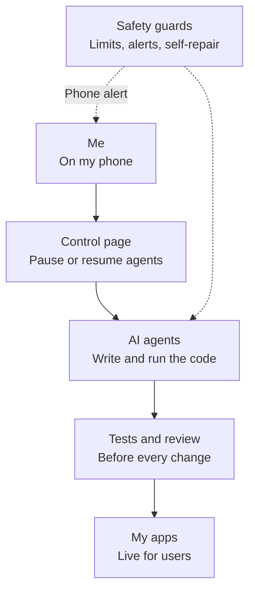

# AI agents on a Raspberry Pi: architecture

Agents are only useful if you can trust them.

I run a small home server where AI agents build and run my apps. One Raspberry Pi, 8 GB of memory.

I built the safety first: limits, a stop button, and tests before every change.

The source code is closed. This page shows how it is built.

[Back to profile](README.md)

> Click on the rows to expand or collapse.

<strong>Architecture</strong>

<blockquote>

Overview

<blockquote>

</blockquote>

Control

<blockquote>

- One phone page lists every running agent.
- Pause or resume one agent, or all of them.
- Each agent shows its state, its last request and what it is doing now.
- Scheduled tasks start agents on a timer, each in its own copy of the code.

</blockquote>

</blockquote>

<strong>Safety and self-repair</strong>

<blockquote>

Safety

<blockquote>

- Heat, load and memory limits. The phone alerts me.
- Google login on everything public. Admin actions need a PIN.
- Paid services are never called in tests.
- No outside messages without my approval.

</blockquote>

Self-repair

<blockquote>

- Open agent sessions are saved every minute and reopened after a restart.
- A watchdog restarts what is down.
- Restarts are capped. After that I get a red alert.
- A rebuild kit sets the Pi up again from scratch. Its test checks it against the live machine.

</blockquote>

</blockquote>

<strong>Quality and delivery</strong>

<blockquote>

Testing

<blockquote>

- Git hooks run all tests before every merge.
- Playwright tests walk through each app like a user.

</blockquote>

Deployment

<blockquote>

- A merge queue merges one change at a time, on top of the latest code.
- Test site first, live site after my approval.

</blockquote>

</blockquote>

<strong>How it was built</strong>

<blockquote>

- AI agents wrote much of the code.
- I set the direction, the rules and the specifications.
- I review the result and own the quality.

</blockquote>

