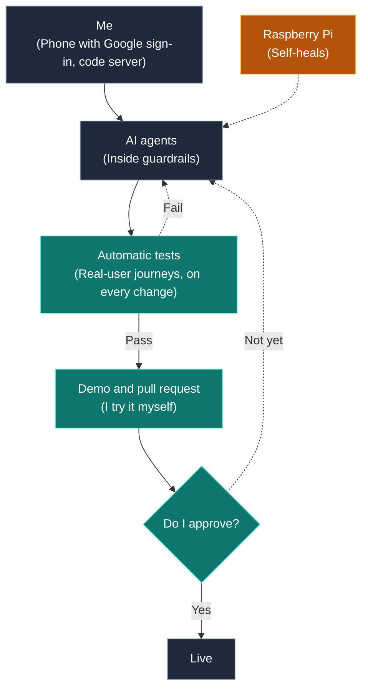

# AI agents on a Raspberry Pi: architecture

Agents are only useful if you can trust them.

I run AI agents on a small home server.

They send me a demo and a pull request. I approve.

I only review demos, so I move faster.

The source code is closed. This page shows how it is built.

[Back to profile](README.md)

> Click on the rows to expand or collapse.

<strong>Architecture</strong>

<blockquote>

Overview

<blockquote>

</blockquote>

</blockquote>

<strong>Control</strong>

<blockquote>

Phone and code server

<blockquote>

- Phone: daily commands, pause and resume. Behind Google sign-in, so only I can reach it.
- Code server: deep dev work in the browser.

</blockquote>

</blockquote>

<strong>AI guardrails</strong>

<blockquote>

Before it goes live

<blockquote>

- Automatic Playwright tests act like a real user, on every change.
- Old features keep working: all tests run each time.
- I try the demo myself, then approve.

</blockquote>

</blockquote>

<strong>Self-healing</strong>

<blockquote>

If the Pi runs hot

<blockquote>

- Phone alert. A watchdog restarts what is down.
- Agent sessions reopen after a restart.

</blockquote>

</blockquote>

<strong>How it was built</strong>

<blockquote>

Roles

<blockquote>

- AI agents wrote much of the code.
- I set the rules and own the quality.

</blockquote>

</blockquote>

