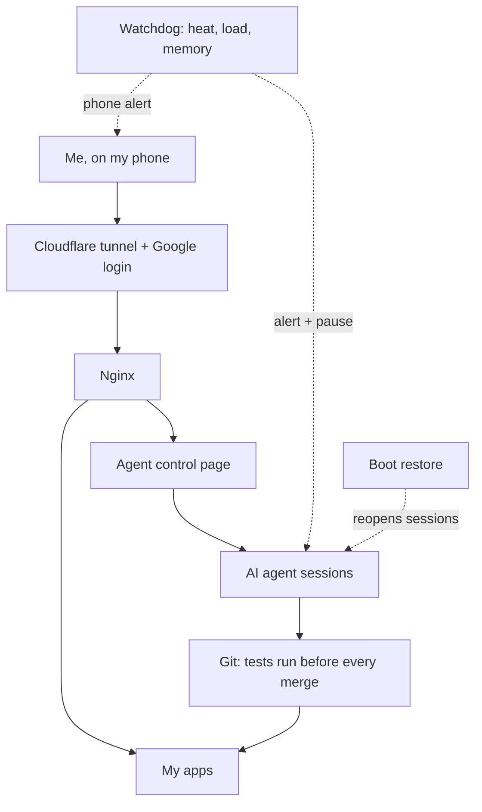

# AI agents on a Raspberry Pi: architecture

A small home server where AI agents build and run my apps.
One Raspberry Pi, 8 GB of memory.

The source code is closed. This page shows how it is built.

[Back to profile](README.md) · [FitGo](fitgo.md)

## Why

Agents are only useful if you can trust them.
So I built the safety first: limits, a stop button, tests before every change.

## Overview

## Control

- One phone page lists every running agent.
- I can pause or resume one agent, or all of them.
- Each agent shows its state, its last request and what it is doing now.
- Scheduled tasks start agents on a timer, each in its own copy of the code.

## Safety

- Heat, load and memory limits. The phone alerts me, and I can pause all agents.
- Paid services are never called in tests.
- Login with Google on everything public. Admin actions need a PIN.
- No outside messages without my approval.

## Self-repair

- Open agent sessions are saved every minute and reopened after a restart.
- A watchdog checks the services and restarts what is down.
- Restarts are capped. After that I get a red alert.
- A rebuild kit can set the Pi up again from scratch. Its test checks it against the live machine.

## Quality

- Git hooks run all tests before a change is merged.
- Playwright tests walk through each app like a user.
- A merge queue lets one change merge at a time, on top of the latest code.
- Staged releases: test site first, live site after my approval.

## What runs on it

- FitGo, a home fitness app.
- JobPilot, a CV tuner for job postings.
- A sprint planner, a to-do app and a status page.

## How it was built

- Agents wrote much of the code.
- I set the direction, the rules and the specifications.
- I review the result and own the quality.
