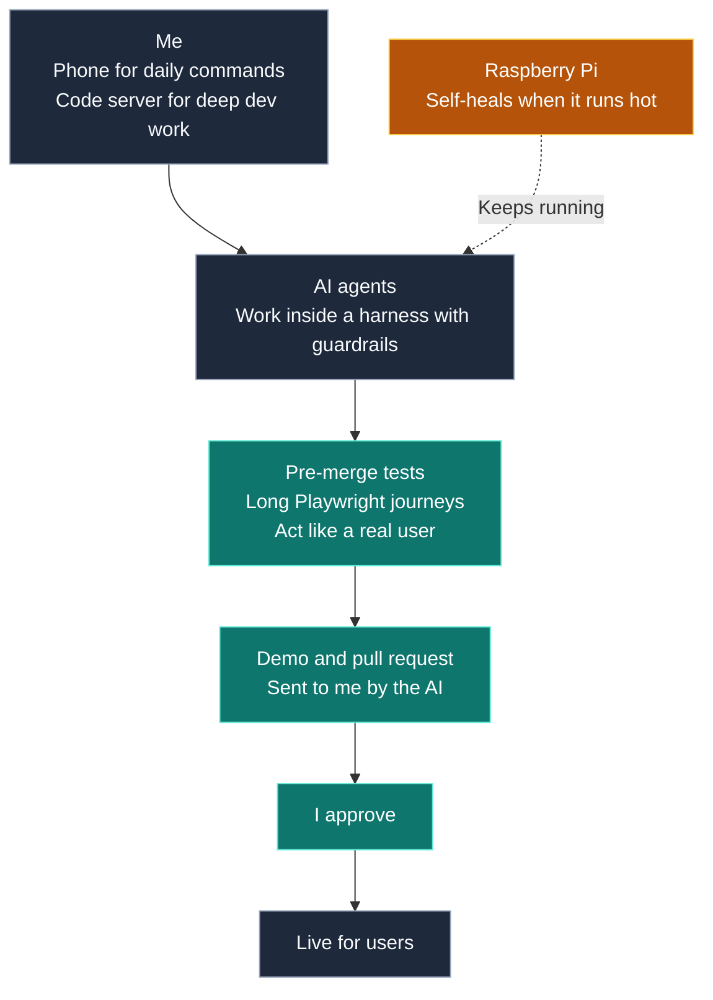

# AI agents on a Raspberry Pi: architecture

Agents are only useful if you can trust them.

I run a small home server where AI agents build and run my apps.

I send daily commands from my phone. For deep work I use a code server.

The agents work inside a harness with guardrails. They send me a demo and a pull request. I approve. That is how I move fast and stay safe.

The source code is closed. This page shows how it is built.

[Back to profile](README.md)

> Click on the rows to expand or collapse.

<strong>Architecture</strong>

<blockquote>

Overview

<blockquote>

</blockquote>

</blockquote>

<strong>AI guardrails</strong>

<blockquote>

Before every merge

<blockquote>

- Git hooks run all unit tests.
- Long Playwright tests walk through each app like a real user.
- A merge queue merges one change at a time.

</blockquote>

Before it goes live

<blockquote>

- The AI sends me a demo and a pull request.
- Test site first. Live site only after my approval.
- Paid services are never called in tests.

</blockquote>

</blockquote>

<strong>Self-healing</strong>

<blockquote>

If the Pi runs hot

<blockquote>

- Heat, load and memory are checked all the time. The phone alerts me.
- A watchdog restarts what is down. Restarts are capped, then I get an alert.
- Agent sessions are saved every minute and reopened after a restart.

</blockquote>

</blockquote>

<strong>Control</strong>

<blockquote>

Phone and code server

<blockquote>

- Phone: one page to see, pause and resume every agent. Google login.
- Code server: a full editor in the browser for deep work.

</blockquote>

</blockquote>

<strong>How it was built</strong>

<blockquote>

Roles

<blockquote>

- AI agents wrote much of the code.
- I set the direction, the rules and the specifications.
- I review the result and own the quality.

</blockquote>

</blockquote>

