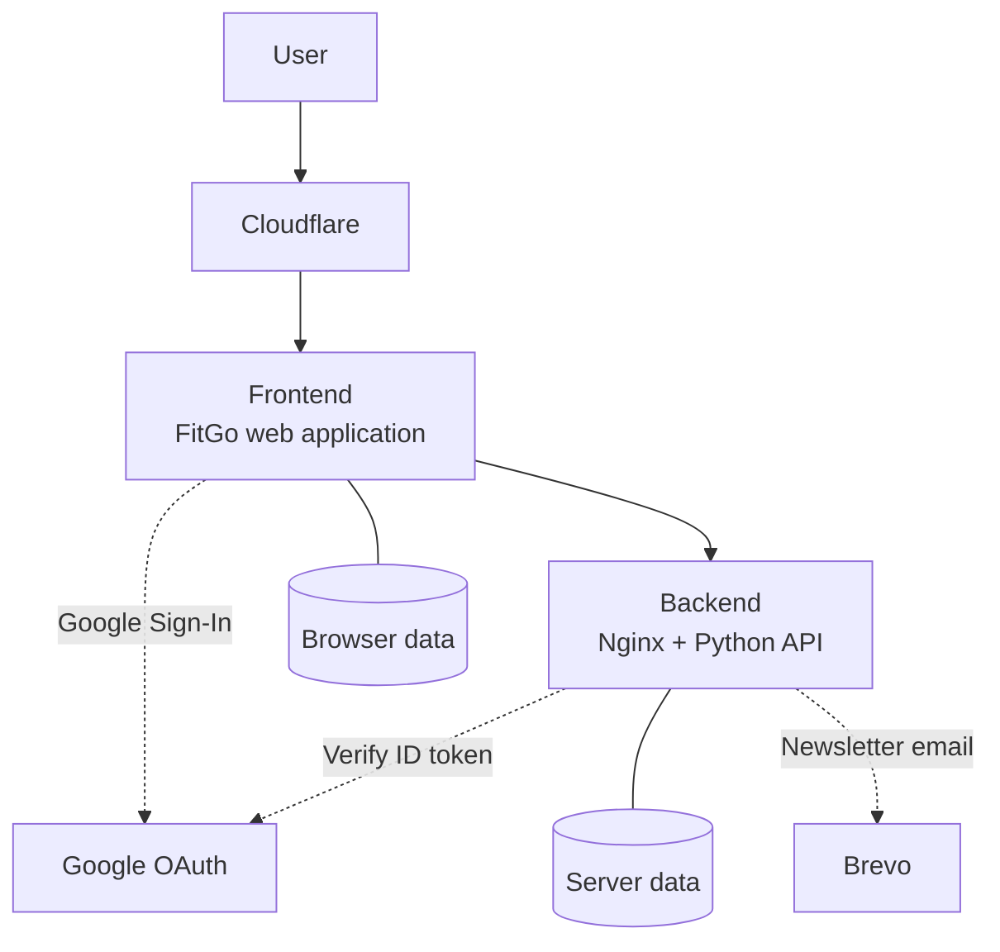

# FitGo: architecture

FitGo is a home fitness web app. One button, press play, follow along.

The source code is closed. This page shows how it is built.

[Open FitGo ↗](https://muriloapps.dpdns.org/fitgo/) · [Back to profile](README.md)

## Background

I wanted a simpler way to exercise at home: one button, press play, follow along.

I started FitGo for myself, and to learn how to build with AI agents.

AI agents wrote much of the code. I set the product direction, architecture and specifications, and I review the quality.

It is now being tested with real users.

[Watch the pitch ↗](https://github.com/user-attachments/assets/47fb315b-e386-4b86-aff1-ef136eb6063d)

## Overview

## Authentication and email

- Google Sign-In for cross-device data synchronisation.
- Brevo for newsletter delivery.

## Testing and deployment

- 34 Playwright end-to-end tests in the pre-merge checks.
- Staged integration and production deployments.
- Automated smoke and core-test checks.

## Privacy and data handling

- Opt-in analytics.
- Consent-based feedback.
- Retention controls.
- Scheduled data purges.

## How it was built

- AI agents wrote much of the code.
- I set the product direction, architecture and specifications.
- I review the code and own the quality.
